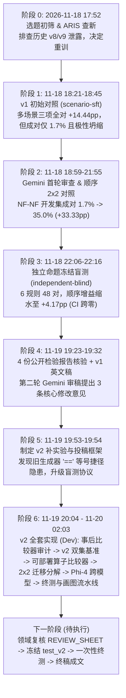

# 论文制作过程与当前实现全景整理（供审查用）

> **整理时间**：2026-11-20  
> **当前稿件题目（v2 叙事稿）**：*When Do Verdicts Follow the Numbers? A Paired Evaluation of a Fine-Tuned Language Model on Chinese Quality-Control Claims*  
> **文档用途**：面向指导者/审稿人/合作者完整还原本论文从选题查新、初版实验、多轮外部审查、设计迭代到 v2 基准与跨模型工程实现的**全过程证据链**，并明确区分**已完成部分**与**待冻结终测部分**。

---

## 1. 一页总览：研究主线与当前进度

### 1.1 核心研究问题与论文演进
本论文关注**小参数语言模型（3B–4B）在小样本 QLoRA 微调下，于规则驱动的中文工业质量判定任务中出现的“证据—结论脱节”现象**：模型在回答中准确报告了观测统计量与判定阈值（例如不合格品数 `8`、接收数 `8`），甚至复述了“不超过接收数即接收”的规则，但给出的最终判定却截然相反（判为“不成立”）；或在关键数值跨过决策边界后，仍对正反两题输出同一结论。

围绕这一现象，研究过程经历了从 **v1（现象发现与单模型探索）** 到 **v2（机制拆解、防捷径基准与跨模型验证）** 的完整升级：

1. **RQ1（数据多样性 vs. 决策灵敏度）**：在近似等 token 预算下，相比同义改写，多场景训练是否同时提升结构化字段正确率与决策边界翻转（成对全对）能力？
2. **RQ2（输出顺序效应与模板迁移）**：将训练与推理输出顺序由“先结论后数值（VF）”改为“先数值后结论（NF）”，是否真能提升成对判定？该增益在独立新模板上能保留多少？
3. **v2 深化问题（三阶段瓶颈定位与工程架构对照）**：
   - 失败究竟源于 **阶段 1（统计量提取/计算错误）**、**阶段 2（比较方向/算子错误）**，还是 **阶段 3（结论绑定与 `==` 等号捷径）**？
   - 在公平对比下，**模型预测统计量/阈值/算子 + 确定性规则比较器（可部署神经符号方案）** 相比端到端微调能修复哪类错误？
   - 上述现象在**跨模型家族（Qwen2.5-3B-Instruct vs. Phi-4-mini-instruct）** 以及 **2×2 迁移分解（措辞变化 × 数值配置变化）** 下是否成立？

### 1.2 当前完成度红绿灯状态

| 模块 | 状态 | 物理位置与核心产出 | 说明 |
|---|---|---|---|
| **选题初筛与 ARIS 查新** | ✅ 已完成 | `idea-stage/IDEA_REPORT.md`、`.aris/traces/` | 完成查新与历史数据防泄露审计，放弃历史有重叠的 v8/v9 旧权重，全部从公开底座重训 |
| **v1 主实验（改写 vs 多场景）** | ✅ 已完成 | `experiments/scenario-sft/` | Qwen2.5-3B，6 个适配器（3 种子）+ 底座 + 256-token 预算敏感性 + 36 题盲抽复核 |
| **首轮 Gemini 外部方法审查 & 顺序 2×2** | ✅ 已完成 | `review-stage/gemini-scenario-sft/`、`experiments/scenario-sft/order-*` | 暴露两大混淆与极性坍缩；完成 2×2 顺序对照与标点/数值分层复算 |
| **v1 独立命题冻结盲测 & 外部报告核验** | ✅ 已完成 | `experiments/independent-blind/`、`experiments/report-sampling/` | 6 规则 48 对 96 题冻结盲测 + 4 份公开检验报告/供应商示例定性核验 |
| **v1 英文稿 & 第二轮 Gemini 审稿** | ✅ 已完成 | `manuscript/manuscript-en-v1.md`、`manuscript/gemini-review.md` | 收到 3 条面向应用计算期刊的硬核审稿意见，直接驱动 v2 改造 |
| **v2 补实验框架 & 叙事升级稿** | ✅ 已完成（⚠️ 待填 v2 数据） | `manuscript/补实验与投稿框架.md`、`manuscript/manuscript-en.md` | 英文稿已完成结构与 Related Work 重写，**但目前正文数据仍为 v1 结果，尚未写入 v2 结果** |
| **v2 事后比较器审计（Oracle）** | ✅ 已完成 | `experiments/posthoc-comparator-audit/` | 对历史开发集与独立盲测集全部输出完成三阶段错误分解与比较器净效应核算 |
| **v2 防捷径双集基准构建（Dev + Test 候选）** | ✅ 已完成（Test 严格未碰） | `experiments/v2-benchmark/` | 12 规则、跨界/同侧/改写三类配对；`dev_v2`（48 组/192 题）已测，`test_v2_candidate`（144 组/576 题）未触碰 |
| **v2 Qwen2.5 算子比较器 & 边界捷径审计** | ✅ 已完成（Dev） | `experiments/v2-operator-comparator/`、`experiments/v2-benchmark/DEV_BOUNDARY_AUDIT.md` | 训练 `VF_op`/`NF_op`（6 适配器），证实 `==` 等号捷径及可部署比较器修复作用 |
| **v2 2×2 迁移分解（措辞 × 数值）** | ✅ 已完成 | `experiments/v2-transfer-decomp/` | 4 格 × 24 对（192 题）解耦措辞偏移与数值配置偏移 |
| **v2 跨模型复现（Phi-4-mini 3.8B）** | ✅ 已完成（Dev） | `experiments/v2-cross-model-phi4/` | 全套 12 个适配器（`VF`/`NF`/`VF_op`/`NF_op` × 3 种子）+ 分词器差异对照 + `dev_v2` 全量评测 |
| **v2 终测冻结/运行脚本 & 论文图表预览** | ✅ 代码就绪（⏳ 等复核签字） | `experiments/v2-final-eval/` | `freeze_test.py`、`run_final_eval.py`、`make_figures.py` 就绪；已产出 4 张 `figures_dev_preview` 预览图 |
| **领域人员审校 `REVIEW_SHEET.md`** | ⏳ **待执行（阻塞点）** | `experiments/v2-benchmark/REVIEW_SHEET.md` | 需人工核验 12 规则边界/等号及 48 条终测模板与改写，记录实审量与纠错数 |
| **终测正式冻结与一次性盲测** | ⏳ **待执行** | `experiments/v2-final-eval/freeze_test.py` → `run_final_eval.py` | 签字后执行一次，校验全部 24 个适配器与测试集 SHA-256，生成 `final_scores.json` 与 `figures_final/` |
| **终稿撰写与定稿** | ⏳ **待执行** | `manuscript/manuscript-en.md` | 将终测结果、双模型表图与人工复核记录整合进投稿终稿 |

---

## 2. 论文制作全过程时间线与决策演化（Process Audit Trail）

本项目的核心特点是**“假设—实验—暴露漏洞—外部审查—协议修正—再验证”的闭环迭代**。所有关键节点均留存了原始日志、协议文件与哈希记录。

### 阶段 0：选题初筛、查新与历史证据边界清理（2026-11-18 17:52）
- **产物**：`project1/idea-stage/IDEA_REPORT.md`、`project1/.aris/traces/novelty-check/2026-11-18_run01/`
- **关键决策**：
  - 在 3 个候选方向中选定“同义改写与多场景训练对民用维修/质检问答泛化的影响”为主线，对标 *DeepKnowledge* (ACL 2025)、*DiagnosticIQ* 等工作。
  - **严格排查历史数据污染**：逐条精确匹配发现早期归档的 `v8` 训练集把 29 道验证题和 10 道回归题全部入训；早期 EOS 降权先导实验（159 样本、单种子、单评分者）区间跨零。因此**明确划定证据边界：不复用任何历史旧权重或旧评测分数**，所有正式实验从公开底座重新训练并记录数据哈希与随机种子。

### 阶段 1：v1 初始对照实验 `scenario-sft`（2026-11-18 18:21–18:45）
- **产物**：`project1/experiments/scenario-sft/`（`protocol.md`、`data.py`、`run.py`、`score.py`、`RESULTS.md`、`audit-packet.json`、`base_budget.py`）
- **实验设计**：
  - 底座 `Qwen2.5-3B-Instruct`，4-bit NF4 QLoRA（`r=16, alpha=32, dropout=0.05, all-linear`，`lr=7e-5`，2 epochs / 48 steps，batch=4，种子 42/43/44，单张 RTX 5060 Ti）。
  - 基于 NIST/SEMATECH 工程统计手册构造 12 条规则（抽样验收 4 条、控制图 WECO 4 条、过程能力指数 4 条）。
  - 同义改写组 vs. 多场景组各 96 题（正反各半），严格匹配预算（总输入 token `14,608` vs `14,610`；监督答案 token `2,848` vs `2,860`）。
  - 测试集在训练前写入并记录哈希：24 道近场景题 + 120 道新场景反转题（60 对，每对仅改变决定结论的一个观测值）。
- **核心发现（意外且关键）**：
  - 多场景训练显著提升了**三项全对率**（`23.3% → 37.8%`，差值 **+14.44 pp**，95% 规则簇区间 `[+8.33, +20.56]`）和**三项覆盖率**（**+7.13 pp**），并彻底消除 96-token 截断（底座触顶 42/120 → 适配器 0/120）。
  - **但两组的成对判断正确率均仅 1.7%**（低于未微调底座的 6.7%），差值 `0.00 pp` `[-2.22, +2.78]`。
  - **揭示极端极性坍缩**：在 120 道正反平衡题中，改写组 3 个种子预测“成立”的次数分别为 `0 / 84 / 12`，多场景组分别为 `0 / 118 / 1`——几乎退化为恒定输出单边标签！
  - **典型病灶案例**：某首样接收题中不合格数=8、接收数=8，种子 42 的两个适配器都输出了“8 和 8”并写对“不超过接收数”，第一行结论却判“不成立”。
  - **辅助校验**：将底座解码预算扩至 256 token，新场景判断（53.3%）、成对（6.7%）与覆盖（41.9%）完全不变；36 份匿名打乱样本抽核结果（底座 2/12、改写 3/12、多场景 4/12）亦印证上述趋势。

### 阶段 2：首轮 Gemini 外部方法审查与答案顺序 2×2 对照（2026-11-18 18:59–21:55）
- **产物**：`project1/review-stage/gemini-scenario-sft/`（`GEMINI_REVIEW.md`、`ORDER_PROTOCOL.md`、`REVIEW_RESULTS.md`、`GEMINI_FINAL_REVIEW.md`、`verified-scores.json`、`numerical-strata.json`、`delimiter-sensitivity.json`）及 `scenario-sft/order-probe/`、`order-training/`
- **审查暴露的两大混淆**：
  1. **多样性与数值覆盖绑定**：12 条规则中有 7 条在给定正负标签后目标数值与阈值恒定（例如 `weco3` 阈值恒 3），仅 5 条随案例变值；且多场景组同时改变工件与数值，无法单独归因。
  2. **先结论后数值阻断自回归计算**：强制第 1 行先输出结论，导致模型在算出/写出统计量和阈值前就被迫押注标签，造成严重极性坍缩。
- **补做 2×2 顺序对照实验**（仅交换前两行：结论先 `VF` vs. 数值先 `NF`，理由仍在第 3 行；新训 3 个 NF 适配器，总计新增 1,872 份推理，并经独立脚本从原始输出复算）：

| 多场景条件（120 题 / 60 对，3 种子均/汇总） | 单题正确率 | 成对全对率 | 逐种子对数 (/60) | 逐种子预测成立 (/120) | 不可解析结论数 |
|---|---:|---:|---|---|---|
| 原训练 (`VF`) + 原提示 (`VF`) | 50.8% | **1.7%** | 0, 2, 1 | 0, 118, 1 | 0, 0, 0 |
| 原训练 (`VF`) + 新提示 (`NF`) | 31.4% | 3.9% (宽标点 5.6%) | 7, 0, 0 | 83, 51, 60 | 0, 54, 51 |
| 新训练 (`NF`) + 原提示 (`VF`) | 53.6% | 7.8% | 4, 4, 6 | 115, 116, 106 | 0, 0, 0 |
| **新训练 (`NF`) + 新提示 (`NF`)** | **66.4%** | **35.0%** | **14, 23, 26** | **73, 72, 65** | 2, 0, 0 |

- **关键诊断结果**：
  - 仅在训练与推理**同时采用数值先行**时，成对正确率由 `1.7%` 跃升至 `35.0%`（**+33.33 pp**，95% 规则簇区间 `[+14.44, +54.44]`）；单改推理提示或单改训练均失效。
  - “双数写对但判错”由 `99/235` 剧降至 `5/227`。
  - **事后分层警示**：增益高度集中在 5 条变值规则（`3/75 → 53/75` 对），7 条定值规则仅从 `0/105 → 10/105` 对。Gemini 终审明确指出：该结果发生在**已用开发模板**上，必须用**权重冻结 + 独立重写模板盲测**检验是否真正迁移。

### 阶段 3：独立命题与权重冻结盲测 `independent-blind`（2026-11-18 22:06–22:16）
- **产物**：`project1/experiments/independent-blind/`（`protocol.md`、`freeze.py`、`manifest.json`、`cases.json`、`RESULTS.md`、`diagnostics.json`）
- **盲测设计**：开启全新 Gemini 会话（不提供旧题与旧结果），基于 Minitab/JMP 参考材料针对 6 条已学规则独立编写 24 套中文模板 × 2 套数值 = **48 对（96 题）**；评测前冻结输入、真值与全部适配器 SHA-256 哈希。
- **核心发现（论文叙事的关键转折点）**：
  - 底座先结论：单题 `52.1%`，成对 `4.2%` (`2/48`)；底座先数值：单题 `43.8%`（含 25 条不可解析），成对 **`12.5%`** (`6/48`)。
  - 微调先结论 (`VF-VF`)：单题 `53.1%`，成对 `6.9%` (`10/144`)；微调先数值 (`NF-NF`)：单题 `53.8%`，成对 **`11.1%`** (`16/144`)。
  - **开发集 +33.33 pp 的大幅收益在独立模板上缩水至 +4.17 pp**（描述性 95% 区间 `[-5.56, +17.36]` 跨零），甚至略低于未微调底座的 `12.5%`！
  - 规则拆分：收益几乎仅存在于一次抽样 `single`（`5/24 → 13/24`），控制图 `zone` 仍 `0/24`，4 条能力指数 `5/96 → 3/96`。
  - 配对四象限拆解：`VF-VF` 有 `133/144` 对重复同一标签，`NF-NF` 仍有 `123/144` 对重复同一标签；在各自 `73/288` 双数均对子集中，仍有 `18/73`（VF）和 `12/73`（NF）给出明确错误判定。

### 阶段 4：外部公开检验报告核验、v1 英文稿与第二轮 Gemini 审稿（2026-11-19 19:23–19:32）
- **产物**：`experiments/report-sampling/`、`manuscript/manuscript-en-v1.md`、`manuscript/gemini-review.md`
- **4 份公开检验文档定性核验**（仅审轻微不合格 `x <= Ac`）：
  - `3268288`（批量 11 抽检 5，`0/0` 应接收）：8 种配置全部判对。
  - `3234769`（批量 1 全检，`1/0` 应拒收）：**全部 8 种配置均读出了实测 1、接收数 0，却全部错判为接收**（底座甚至写出“1 件，小于接收数 0”）。
  - `vicc-cleaner`（`4/7` 应接收）与 `vicc-motor`（`0/21` 应接收）：`VF` 三个种子一律判接收（含错判 `3234769`）；`NF` 三个种子在两份示例上**全部列对数值却全部错判为拒收**（写反比较方向）。
- **第二轮 Gemini 审稿意见（3 条直接驱动 v2 改造）**：
  1. 补全实验矩阵、配对四象限与单题错误分阶段拆解，区分格式不合规与推理错误；
  2. 独立测试集仅 6 规则且含 4 条高度同源能力指数，簇 bootstrap 违反独立性；且缺领域专家审校、缺 `near-scenario` 与两份供应商示例在正文中的完整对齐；
  3. 作为应用/AI 论文，不能止步于报告端到端低分，必须增加**显式比较/神经符号解耦基线（字段抽取 + 确定性规则执行）**并结构化沉淀审计协议。

### 阶段 5：制定 v2 补实验与投稿框架（2026-11-19 19:53–19:54）
- **产物**：`manuscript/补实验与投稿框架.md`、`manuscript/manuscript-en.md`
- **关键方法学洞察（避免“假高分”）**：
  - 自查发现原一次抽样生成器把正例恒放在 `x = c`、反例恒放在 `x = c + 1`——一个只学会“见到 `x == c` 就接收”的捷径模型也能拿满跨界配对分，但面对 `x = c - 1` 就会错判拒收！
  - 因此 v2 基准必须针对每个基础配置同时构造 **跨界对（如 8→9）**、**同侧对（正侧 7→8 与负侧 9→10，50/50 平衡，覆盖 `below / at / above`）** 与 **等义改写对（8→8 换措辞）**。
  - 文献对位聚焦 *NumPert* (IJCNLP-AACL 2025)、*Structure Tax* (IJCNLP-AACL 2026)、*TabVer* (TACL 2024)、*GSM-Symbolic* (ICLR 2025)、*FORGE* (EMNLP 2026) 等。
  - 统计口径全面升级：固定 12 条规则，改用**规则内模板簇配对 bootstrap** + **去一模板敏感性** + **逐种子均值与范围并列（绝不把 3 种子乘入独立样本量）**。

### 阶段 6：v2 全套工程实现与开发集验证（2026-11-19 20:04 – 2026-11-20 02:03）
严格遵循“先在历史输出与 `dev_v2` 完成全部诊断、开发、跨模型训练与代码冻结，**绝不触碰 `test_v2_candidate.json`**”的盲测纪律，依次落地 6 个实验模块（详述见第 3 节）。

---

## 3. 已完成的核心实现与实证结果汇总

### 3.1 硬件、统一超参及 27 个已训练适配器清单
- **计算环境**：本地单卡 `NVIDIA GeForce RTX 5060 Ti`，`torch 2.9.1+cu128`、`transformers 4.57.3`、`bitsandbytes 0.48.2`、`peft 0.18.0`，全离线模式（`HF_HUB_OFFLINE=1`）。
- **统一训练配置**：4-bit NF4 双量化（`bfloat16` 计算），LoRA `r=16, alpha=32, dropout=0.05, target_modules="all-linear"`，AdamW `lr=7e-5, weight_decay=0.0`，余弦学习率调度（warmup 2 步），仅对监督答案 token 计算交叉熵损失（mask 提示与 padding），2 epochs = 48 优化步（有效 batch=4），末轮权重，3 个配对种子 `42 / 43 / 44`。
- **工程优化细节（Phi-4-mini）**：由于 `Phi-4-mini-instruct` 词表约 200k，为防止 Windows WDDM 显存换页，实现了 `micro_batch=1` + 精确按监督 token 数加权的梯度累积，且仅对 `valid` 监督位置投影 `lm_head` 计算交叉熵（与全序列 Causal LM 损失数学上 100% 等价，显存降约 6×，推理峰值 3.14 GiB）。
- **统一推理配置**：贪心解码（greedy），batch=12，`max_new_tokens=96`。
- **分词器 token 差异记录（同一 96 条训练样本/轮）**：

| 训练条件 | Qwen2.5-3B 总输入 / 监督答案 token | Phi-4-mini 总输入 / 监督答案 token | 备注 |
|---|---:|---:|---|
| `VF` / `NF` | 14,610 / 2,860 | 15,516 / 3,164 | 同一 96 题 `scenario.json`，仅互换前两行 |
| `VF_op` / `NF_op` | 15,882 / 3,268 | 16,788 / 3,572 | 在数值行追加 `，算子=<= / >= / >` |

- **适配器总清单（共 27 个；其中 24 个进入 v2 终测冻结池，全部位于 `D:\Users\Administrator\Desktop\project1\experiments\` 下）**：
  - v1 对照独有（3 个）：`experiments/scenario-sft/runs/paraphrase-{42,43,44}`
  - Qwen2.5-3B-Instruct 终测池（12 个）：`VF`（`experiments/scenario-sft/runs/scenario-*`）、`NF`（`experiments/scenario-sft/order-training/scenario-*`）、`VF_op` & `NF_op`（`experiments/v2-operator-comparator/runs/`）各 3 种子
  - Phi-4-mini-instruct 终测池（12 个）：`VF`、`NF`、`VF_op`、`NF_op`（`experiments/v2-cross-model-phi4/runs/`）各 3 种子

---

### 3.2 模块 1：历史输出的事后规则已知比较器审计（`posthoc-comparator-audit`）
在不动模型权重、不增算子提示的前提下，用参考规则方向 + 模型自报的 `统计量/阈值` 执行确定性比较（对应方案 §4 第 4 行 Oracle-Rule Comparator），先校验“真值字段+真值规则”在全部 120 题开发集与 96 题盲测集上 100% 吻合，再定位阶段瓶颈：

- **历史开发反转集（`far.json`，60 对/种子）**：
  - `SFT_VF_train_VF_infer`：端到端成对仅 **1.7%** (`3/180`)，接入比较器后飙升至 **45.0%** (`81/180`，净纠正 +79 / 改错 -1），其中抽样族从 `5.0% → 86.7%`！说明 VF 适配器其实已经学会了大部分数值提取，主要是被“先输出结论”阻断了判定。
  - `SFT_NF_train_NF_infer`：端到端成对 **35.0%** (`63/180`)，接入比较器仅小幅升至 **37.2%** (`67/180`)。单题错误分解显示，双数对判错已降至仅 `5/360`，剩余错误主要来自**仅统计量错 `119/360`**（集中在能力指数计算与部分控制图计数）。
- **历史独立盲测集（`independent-blind/cases.json`，48 对/种子）**：
  - 抽样族 `single`：双数均对率高达 **97.9%–100%**，但端到端成对仅 `20.8%`（VF）与 `54.2%`（NF）；接入比较器后直接跃升至 **`95.8%` 与 `100.0%`**。
  - 能力指数与控制图：仅统计量错高达 `159–161/192`（能力指数）与 `48/48`（控制图），比较器几乎无法挽回（仍为 `2.1%` 和 `0.0%`）。
  - **结论**：清晰分离出两个独立瓶颈——**抽样类卡在“数值→判定”绑定（可被顺序/比较器修复），能力指数与控制图卡在“统计量计算/计数”（纯输出格式无法修复）**。

---

### 3.3 模块 2：v2 防捷径评测基准与自动化校验（`v2-benchmark`）
- **核心代码**：`rules.py`（精确分数 `Fraction` 真值引擎）、`templates.py`（全新中文工业场景模板与等义改写库）、`build_dataset.py`、`scorer.py`、`audit_dev_boundaries.py`、`REVIEW_SHEET.md`。
- **数据集结构与严格隔离**：

| 数据集 | 规则数 | 模板/规则 | 配置/模板 | 基础题组 | 总题数 | 跨界对 | 同侧对 (正/负) | 改写对 | 边界位置 (`below / at / above`) | 状态 |
|---|---:|---:|---:|---:|---:|---:|---:|---:|---|---|
| `dev_v2.json` | 12 | 2 | 2 | 48 | 192 | 48 | 48 (24/24) | 48 | `84 / 47 / 61` | 已用于开发评测 |
| `test_v2_candidate.json` | 12 | 4 | 3 | 144 | 576 | 144 | 144 (72/72) | 144 | `252 / 141 / 183` | **严格未触碰**，待复核冻结 |

- **8 项自动化质检断言全部通过**（记录于 `v2-benchmark/data/manifest.json`）：
  1. 精确分数真值与浮点比较器 100% 一致；
  2. 能力指数舍入歧义防护（按未舍入精确值判定，剔除因展示舍入可能翻转边界的题）；
  3. 所有跨界对与同侧对严格仅编辑单一观测量；
  4. 所有 WECO 控制图窗口对严格仅编辑单一数据点；
  5. 所有改写对输入数值完全一致且题面措辞改变；
  6. 每条规则的同侧正例对与同侧负例对严格 50/50 平衡；
  7. `dev_v2`、`test_v2_candidate` 与全部历史集合之间**零题面重叠**；
  8. 工件词池在三集合之间**完全互斥**。
- **终测样本量与置信区间宽度模拟**（基于 `dev_v2` 模板间配对分歧标准差 `36.53 pp`）：
  - 当终测为每规则 4 模板（共 48 模板、144 题组）时，主效应 `NF-NF − VF-VF` 的预期 95% CI 半宽为 `±10.07 pp`（总宽 `20.14 pp`），在预期效应约 +15 至 +20 pp 时具备足够统计分辨力。

---

### 3.4 模块 3 & 5：双模型在 `dev_v2` 上的完整对照（Qwen2.5-3B vs. Phi-4-mini）
下表汇总两款完全不同模型家族（Alibaba Qwen2.5-3B-Instruct 3.1B vs. Microsoft Phi-4-mini-instruct 3.8B）在同一 `dev_v2.json`（48 组 / 192 题，微调为 3 种子合计 144 组 / 576 题）上的表现：

| 模型 | 条件 | 算子正确率 | 端到端跨界双对 | 可部署比较器跨界 | 规则已知比较器跨界 | 端到端同侧双对 | 端到端改写双对 | 不可解析题数 |
|---|---|---:|---:|---:|---:|---:|---:|---:|
| **Qwen2.5-3B** | `base_VF` / `base_NF` | — | 4.2% / 8.3% | — | 25.0% / 4.2% | 45.8% / 41.7% | 39.6% / 33.3% | 0 / 13 |
| **Qwen2.5-3B** | `VF_train_VF_infer` | — | **2.1%** (3/144) | — | 41.0% (59/144) | 51.4% | 30.6% | 0 |
| **Qwen2.5-3B** | `VF_train_NF_infer` | — | 9.0% (13/144) | — | 33.3% (48/144) | 20.8% | 13.2% | 215 |
| **Qwen2.5-3B** | `NF_train_VF_infer` | — | 0.0% (0/144) | — | 22.9% (33/144) | 48.6% | 48.6% | 0 |
| **Qwen2.5-3B** | `NF_train_NF_infer` | — | **22.9%** (33/144) | — | 32.6% (47/144) | 46.5% | 41.7% | 0 |
| **Qwen2.5-3B** | `SFT_VF_op` | 83.2% (479/576) | 4.2% (6/144) | **27.8%** (40/144) | 33.3% (48/144) | 47.9% (比 54.9%) | 27.8% (比 42.4%) | 0 |
| **Qwen2.5-3B** | `SFT_NF_op` | 85.4% (492/576) | 20.8% (30/144) | **27.8%** (40/144) | 38.9% (56/144) | 50.7% (比 56.9%) | 41.7% (比 47.2%) | 0 |
| **Phi-4-mini** | `base_VF` / `base_NF` | — | 0.0% / 0.0% | — | 0.0% / 2.1% | 14.6% / 12.5% | 0.0% / 6.2% | 148 / 131 |
| **Phi-4-mini** | `VF_train_VF_infer` | — | **2.8%** (4/144) | — | 22.2% (32/144) | 47.9% | 39.6% | 0 |
| **Phi-4-mini** | `VF_train_NF_infer` | — | 0.7% (1/144) | — | 17.4% (25/144) | 47.9% | 47.9% | 11 |
| **Phi-4-mini** | `NF_train_VF_infer` | — | 0.0% (0/144) | — | 23.6% (34/144) | 47.9% | 41.7% | 6 |
| **Phi-4-mini** | `NF_train_NF_infer` | — | **18.1%** (26/144) | — | 25.7% (37/144) | 44.4% | 32.6% | 0 |
| **Phi-4-mini** | `SFT_VF_op` | 71.2% (410/576) | 4.2% (6/144) | **16.0%** (23/144) | 25.7% (37/144) | 45.8% | 32.6% | 0 |
| **Phi-4-mini** | `SFT_NF_op` | 65.3% (376/576) | 10.4% (15/144) | **12.5%** (18/144) | 22.9% (33/144) | 43.8% | 31.9% | 0 |

- **规则内模板簇配对 Bootstrap 主效应（95% CI）**：
  1. **输出顺序主效应（`NF-NF − VF-VF`，端到端跨界双对）**：
     - Qwen2.5-3B：**`+20.83 pp`** `[+13.19, +28.47]`（去一模板敏感性 `[+16.67, +25.00]`）；同侧双对 `-4.86 pp` `[-11.81, +2.08]`（无显著退化）；改写双对 `+11.11 pp` `[+2.08, +20.83]`。
     - Phi-4-mini：**`+15.28 pp`** `[+8.33, +22.22]`。**顺序效应在第二模型家族上成功复现！**
  2. **可部署算子比较器净增益（同一输出上：可部署比较器 − 端到端）**：
     - `SFT_VF_op`：Qwen **`+23.61 pp`** `[+17.36, +29.86]`；Phi-4 **`+11.81 pp`** `[+3.47, +20.14]`（双模型均显著，且显著缩小 VF 与 NF 的差距）。
     - `SFT_NF_op`：Qwen **`+6.94 pp`** `[-0.00, +13.89]`；Phi-4 **`+2.08 pp`** `[-3.47, +7.64]`。注意在 Phi-4 上追加算子监督反而使其 `SFT_NF_op` 端到端（10.4%）低于纯 `NF-NF`（18.1%），且算子正确率仅 65.3%，说明**可部署比较器的有效上限直接受制于模型预测比较算子的准确率**（这是非常有价值的差异化发现）。
  3. **公平性校验（追加算子提示本身对端到端的影响）**：在 Qwen 上，`SFT_NF_op` 端到端 vs 原 `NF-NF` 为 `-2.08 pp` `[-5.56, +1.39]`，`SFT_VF_op` vs 原 `VF-VF` 为 `+2.08 pp` `[-0.69, +4.86]`，均跨零，证明比较器增益不是靠多加一句提示带来的。

---

### 3.5 核心机制发现：`==` 等号捷径实锤与可部署比较器破局
`v2-benchmark/DEV_BOUNDARY_AUDIT.md` 与 `v2-operator-comparator/DEV_OP_REPORT.md` 的边界位置（`below / at / above`）诊断给出了极具冲击力的实证：

| 规则（真算子） | 边界位置 | Qwen `NF-NF` 端到端 | Qwen `SFT_NF_op` 端到端 | Qwen `SFT_NF_op` 可部署比较器 | Qwen `SFT_VF_op` 可部署比较器 | Phi-4 `NF-NF` 端到端 | Phi-4 `SFT_VF_op` 可部署比较器 |
|---|---|---:|---:|---:|---:|---:|---:|
| `single` (`<=`) | **`below` (`x < c`)** | **0/15 (0.0%)** | **0/15 (0.0%)** | **14/15 (93.3%)** | **15/15 (100.0%)** | 7/15 (46.7%) | 13/15 (86.7%) |
| `single` (`<=`) | `at` (`x = c`) | 9/9 (100.0%) | 9/9 (100.0%) | 9/9 (100.0%) | 9/9 (100.0%) | 9/9 (100.0%) | 9/9 (100.0%) |
| `first_accept` (`<=`) | **`below` (`x < c`)** | **0/15 (0.0%)** | **0/15 (0.0%)** | **11/15 (73.3%)** | **12/15 (80.0%)** | 9/15 (60.0%) | 4/15 (26.7%) |
| `first_accept` (`<=`) | `at` (`x = c`) | 8/9 (88.9%) | 7/9 (77.8%) | 9/9 (100.0%) | 8/9 (88.9%) | 5/9 (55.6%) | 8/9 (88.9%) |
| `weco3` (`>`) | **`at` (`z = 3.0`)** | **0/9 (0.0%)** | 5/9 (55.6%) | 2/9 (22.2%) | 3/9 (33.3%) | **0/9 (0.0%)** | 4/9 (44.4%) |
| `weco3` (`>`) | `above` (`z > 3.0`) | 24/24 (100.0%) | 23/24 (95.8%) | 23/24 (95.8%) | 24/24 (100.0%) | 23/24 (95.8%) | 20/24 (83.3%) |

- **实锤发现 1（`==` 捷径）**：Qwen 的端到端 `NF-NF` 虽然在 `at` 边界（`x == c`）拿到 100% / 88.9%，但在 `below`（`x < c`）竟然是 **0/15 (0.0%)**！这意味着它在旧训练分布上并非真正学会了 `<=`，而是学成了**“相等才成立”的退化捷径**。引入可部署算子比较器后，`below` 准确率瞬间修复至 **73.3%–100.0%**！
- **实锤发现 2（严格 `>` 边界失误）**：在 `weco3`（严格大于 `3.0`）的 `z = 3.0` 边界点，两款模型的 `NF-NF` 均为 **0/9 (0.0%)**（全把 `3.0` 误判为越限）；且即使在可部署比较器中，因模型常把 `>` 错预测为 `>=`，`at` 点准确率也仅 22.2%–55.6%，直接暴露了“严格不等式算子识别”这一独立短板。

---

### 3.6 模块 4：2×2 迁移分解实验（`v2-transfer-decomp`）
针对 v1 独立盲测增益大幅缩水的成因，构造 **旧/新措辞 × 原/新数值配置** 4 格（共享全部 12 条规则，每格 24 对 / 48 题，共 192 题），评测已冻结 Qwen2.5-3B 适配器（3 种子 72 对/格）：

| Qwen `NF-NF` 格子 | 总体端到端成对 | 总体比较器成对 | 抽样族 (端到端 / 比较器) | 控制图 (端到端 / 比较器) | 能力指数 (端到端 / 比较器) |
|---|---:|---:|---:|---:|---:|
| 旧措辞 × 原数值 | 38.9% (28/72) | 41.7% (30/72) | 66.7% / 75.0% | 25.0% / 25.0% | 25.0% / 25.0% |
| 新措辞 × 原数值 | 40.3% (29/72) | 41.7% (30/72) | 83.3% / 91.7% | 29.2% / 25.0% | **8.3% / 8.3%** |
| 旧措辞 × 新数值 | 33.3% (24/72) | 31.9% (23/72) | 79.2% / 62.5% | 12.5% / 25.0% | **8.3% / 8.3%** |
| 新措辞 × 新数值 | 33.3% (24/72) | 40.3% (29/72) | 79.2% / 87.5% | 16.7% / 29.2% | **4.2% / 4.2%** |

- **主效应分解**：总体上**措辞偏移主效应均值 `+0.7 pp`**，**数值配置偏移主效应均值 `-6.2 pp`**。
- **规则族异质性**：抽样族对措辞和数值变化都相当鲁棒（66.7%–83.3%）；而**能力指数族极其脆弱**，无论只换措辞还是只换数值，成对率立刻从 `25.0%` 暴跌至 `8.3%`，两者同换跌至 `4.2%`——这完满解释了为什么 v1 独立盲测（2/3 为能力指数规则）收益大幅萎缩。

---

### 3.7 模块 6：终测防作弊冻结流水线与论文图表（`v2-final-eval`）
- `freeze_test.py`：仅在领域人员完成 `REVIEW_SHEET.md` 复核后运行一次，强制重新校验 576 题精确真值与零泄露，将 `test_v2_candidate.json` 复制为 `frozen_test_v2.json`，并将测试集、评分/规则代码以及**全部 24 个适配器权重**的 SHA-256 写入 `freeze_manifest.json`（如已冻结则拒绝覆盖）。
- `run_final_eval.py`：启动前硬校验 `freeze_manifest.json` 中每一个文件与全部 24 个适配器的哈希，任何漂移立即中止，保证单次无回退盲测。
- `make_figures.py`：支持 `--mode dev`（当前已生成 4 张预览图于 `figures_dev_preview/`，PDF + 300 DPI PNG，色盲友好 Okabe-Ito 配色）与 `--mode final`（终测后一键出投稿终图）：
  - `fig1_protocol_overview`：配对行为评测与三阶段错误分解协议全景图
  - `fig2_per_rule_seed_effects`：12 条规则 × 3 种子 × 双模型的输出顺序效应与可部署比较器净增益点图
  - `fig3_boundary_shortcut_and_stages`：边界等号捷径诊断（`below/at/above`）+ 三规则族三阶段瓶颈对比图
  - `fig4_transfer_2x2`：2×2 迁移分解（措辞偏移 vs. 数值配置偏移）柱状图

---

## 4. 目录与文件索引（便于审查人逐项抽检）

本论文项目全部产物已统一归集于 **`D:\Users\Administrator\Desktop\project1\`**（本地共享基础模型与 Python 虚拟环境仍位于 `D:\Users\Administrator\Desktop\finetune\`）：

- **选题与查新**：
  - `idea-stage/IDEA_REPORT.md` & `.aris/traces/novelty-check/` — 选题初筛与查新轨迹
- **v1 实验与外部审查**：
  - `experiments/scenario-sft/` — v1 主实验、2×2 顺序对照代码与 9 个旧适配器（其中 6 个复用为 Qwen `VF`/`NF`）
  - `review-stage/gemini-scenario-sft/` — Gemini 首轮方法审查、独立复算脚本与分层诊断
  - `experiments/independent-blind/` — v1 6 规则 48 对冻结盲测
  - `experiments/report-sampling/` — 4 份公开检验报告与供应商示例定性核验
- **v2 补实验、跨模型与终测流水线**：
  - `experiments/posthoc-comparator-audit/REPORT.md` — 历史输出的事后规则已知比较器诊断
  - `experiments/v2-benchmark/` — `rules.py`、`templates.py`、`build_dataset.py`、`scorer.py`、`dev_v2.json`、`test_v2_candidate.json`、`REVIEW_SHEET.md`、`DEV_REPORT.md`、`DEV_BOUNDARY_AUDIT.md`
  - `experiments/v2-operator-comparator/` — Qwen `VF_op`/`NF_op` 训练与 `DEV_OP_REPORT.md`
  - `experiments/v2-transfer-decomp/` — 2×2 迁移分解与 `TRANSFER_REPORT.md`
  - `experiments/v2-cross-model-phi4/` — Phi-4-mini 12 个适配器、分词器对比与 `PHI4_DEV_REPORT.md`
  - `experiments/v2-final-eval/` — `freeze_test.py`、`run_final_eval.py`、`make_figures.py`、`figures_dev_preview/fig1..4`
- **文稿与审稿记录**：
  - `manuscript/manuscript-en-v1.md` & `manuscript/gemini-review.md` — v1 英文初稿与第二轮审稿意见
  - `manuscript/补实验与投稿框架.md` & `manuscript/manuscript-en.md` — v2 方案与叙事升级英文稿（待填入 v2 数据）

---

## 5. 请重点审查的方法学与流程问题清单（Review Checklist）

在正式冻结 `test_v2_candidate.json` 并运行一次性盲测前，建议审查人重点把关以下 **6 个关键问题**：

1. **训练数据沿用旧 `scenario.json` 的实验解释边界**
   - 当前 v2 全部 24 个适配器均复用历史 96 题 `scenario.json`（仅调换顺序或追加算子字段），这很好地保留了“在未重训/固定旧分布条件下暴露 `==` 等号捷径”的诊断价值；
   - **待审问题**：审稿人是否会质疑“为什么不在 v2 也加一组含 `below/at/above` 覆盖的新训练集作为上界对照”？还是将其清晰界定为“小样本有偏训练分布下的行为审计（behavioral audit）”更为自洽？
2. **领域复核 `REVIEW_SHEET.md` 的合规深度与执行人**
   - 目前 `test_v2_candidate.json` 的 48 套模板由程序/AI 辅助编写，尚未经过人工领域复核。
   - **待审问题**：由谁签字复核（作者自查 vs. 邀请 1–2 名质量/制造背景人员独立核查）？是否需要在论文中明确区分“人工校验模板无歧义性”与“真实工厂抽样框外推”？
3. **Phi-4-mini 在 `SFT_NF_op` 上性能回落与算子预测偏低的解释**
   - 在 `dev_v2` 上，Phi-4-mini 的 `SFT_NF_op` 算子准确率仅 `65.3%`（Qwen 为 `85.4%`），且 `SFT_NF_op` 端到端跨界（10.4%）反而低于纯 `NF-NF`（18.1%），在 `first_accept`/`above` 上可部署比较器甚至出现 `0/24 (0.0%)`。
   - **待审问题**：在进入终测前，是否需要排查 `SFT_NF_op` 的具体错误样本（例如是否因 Phi-4 对中文“算子=<=”符号串分词或 48 步收敛不足所致），还是如实将其作为跨模型异质性（“算子预测本身成为神经符号系统的第二瓶颈”）写入分析？
4. **统计推断口径是否足够稳健**
   - v2 已放弃 v1 的 6 规则簇 bootstrap，改为“固定 12 条规则，在规则内按模板簇配对重采样 + 去一模板敏感性 + 逐种子单独汇报”。
   - **待审问题**：终测每规则 4 个模板（共 48 模板簇）的配对重采样区间，在目标期刊（计算机/AI 或应用计算）审稿标准下是否需要补充精确配对检验（如模板级配对置换检验 / Wilcoxon）作为辅助？
5. **AI 工具协作透明披露**
   - 制作过程中使用了 ARIS 查新、Gemini（独立命题与两轮方法/稿件审查）以及 Codex/Antigravity（编码、复算与整理），所有过程文件与事件日志均完整保留于统一目录 `project1/`。
   - **待审问题**：投稿时“Reproducibility and tool use / AI disclosure”段落的表述尺度是否符合目标期刊政策？
6. **英文稿现状提醒（避免误判）**
   - `manuscript/manuscript-en.md` 目前仅完成了**引言、Related Work 与方法叙事重构**，正文实验表格仍为 **v1 数据**；v2 的全部开发集结果、Phi-4-mini 跨模型结果、可部署算子比较器与 2×2 迁移分解均尚未写入正文，须在完成一次性冻结终测后统一回写并定稿。
